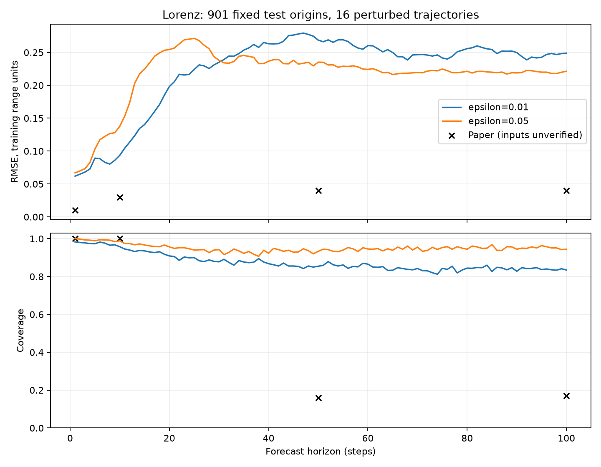

# Повторная сверка реализации со статьёй

Четыре отступления от текста исправлены: рекурсивный вес `wavgc`, сумма `cwat`, два лишних признака классификаторов и набор оцениваемых точек. Веса и признаки проверены отдельно на исходных данных и прежних 901 origins. Новый основной эксперимент оценивает все 1000 test-targets на каждом горизонте, как в формуле (7).

## Что изменено и почему

| Место статьи | Прежняя реализация | Исправление |
|---|---|---|
| §3.4, формулы (4)/(5), комбинированный вес | Всегда передавалось среднее depth-весов | Для взвешенного UPV передаётся средний использованный вес; у `wavgc` это depth × distance |
| §4, техника `cwat` | Сумма `2^-j` делилась на сумму весов | Используется напечатанная сумма без дополнительной нормировки |
| §4, признаки классификаторов | 12 признаков, включая число кандидатов и полный размах | Только десять перечисленных признаков; два остальных доступны для диагностики |
| Формула (7), `t+h ∈ Y2` | 901 полное окно, разные подмножества test для разных горизонтов | Все 1000 test-targets на каждом горизонте; origin = target − h |

У `cwat` буквальная формула и словесное «взвешенное среднее» расходятся: при конечном числе путей сумма весов меньше 1. Здесь выбрана формула; даже одинаковые постоянные траектории могут быть отвергнуты при малом пороге. Это отдельная неоднозначность статьи, а не заявленное улучшение качества.

Для нового тестового протокола самый ранний origin расположен за 100 шагов до первого target. Поэтому последние 99 значений validation исключены из калибровки всех моделей, включая baseline. Иначе настройка использовала бы информацию из будущего относительно этого origin. Данные, нормализация, Wishart-мотивы и гиперпараметры по умолчанию сохранены.

## Контроль на неизменной выборке

Исходный коммит: `5478c7625d79b88833c3aad905aa253b06471625`. Те же данные, прежние 113 validation-окон, 901 test-origin, горизонты 1–100. RMSE условная по принятым прогнозам, в единицах нормированного ряда; покрытие показано вместе с ней. Тест не использовался для выбора правок.

| Ряд | Метод | RMSE до | RMSE после | Покрытие до | Покрытие после |
|---|---|---:|---:|---:|---:|
| germany | `cl_avg_adblr` | 0.187713 | 0.207967 | 8.58% | 28.97% |
| germany | `cl_avg_adbsvm` | nan | nan | 0.00% | 0.00% |
| germany | `cl_avg_dt` | 0.195544 | 0.202264 | 11.24% | 11.24% |
| germany | `cl_avg_knn` | 0.201060 | 0.199425 | 12.76% | 13.23% |
| germany | `cl_avg_lr` | 0.170707 | 0.207237 | 5.12% | 28.42% |
| germany | `cl_avg_lrs` | 0.171540 | 0.207575 | 5.21% | 28.64% |
| germany | `cl_avg_lrv` | 0.166917 | 0.207549 | 5.51% | 28.52% |
| germany | `cl_avg_mlp` | 0.167372 | 0.207551 | 4.26% | 28.66% |
| germany | `cl_avg_svm` | 0.201395 | 0.202484 | 26.65% | 27.70% |
| germany | `cl_wavgc_cm` | 0.236524 | 0.234447 | 90.80% | 90.82% |
| germany | `cl_wavgd_cm` | 0.235464 | 0.235464 | 90.74% | 90.74% |
| lorenz | `cl_avg_adblr` | 0.180888 | 0.213388 | 27.77% | 42.85% |
| lorenz | `cl_avg_adbsvm` | 0.008160 | 0.241107 | 0.02% | 93.31% |
| lorenz | `cl_avg_dt` | 0.173860 | 0.174931 | 20.91% | 20.64% |
| lorenz | `cl_avg_knn` | 0.160082 | 0.171445 | 20.66% | 21.58% |
| lorenz | `cl_avg_lr` | 0.185260 | 0.214111 | 29.29% | 41.06% |
| lorenz | `cl_avg_lrs` | 0.190856 | 0.213958 | 31.70% | 41.00% |
| lorenz | `cl_avg_lrv` | 0.185260 | 0.214111 | 29.29% | 41.06% |
| lorenz | `cl_avg_mlp` | 0.180082 | 0.206812 | 27.34% | 38.12% |
| lorenz | `cl_avg_svm` | 0.214577 | 0.226768 | 48.42% | 59.35% |
| lorenz | `cl_wavgc_cm` | 0.244256 | 0.237482 | 99.91% | 99.91% |
| lorenz | `cl_wavgd_cm` | 0.244523 | 0.244523 | 99.79% | 99.79% |

Исправление `wavgc` уменьшило RMSE на обоих рядах при почти неизменном покрытии. Изменение признаков не даёт общего улучшения: часто растут и покрытие, и ошибка. Полная таблица [controls.csv](audit/controls.csv) также содержит сравнение на **пересечении** принятых точек до/после; отдельные матрицы прогнозов сохранены. Показатели на разных собственных масках нельзя интерпретировать как сравнение ошибки на одних точках.

`wavgd` меняет передаваемую надёжность, но его следующие UPV зависят только от distance, поэтому численные прогнозы остаются прежними. `cwat` не входит в 21 опубликованную экспериментальную строку: изменение проверено отдельным тестом, но не приписывается улучшению табличных результатов.

## Что уже соответствовало статье

Хронологические координаты мотивов совпадают с примером §3.2 и Algorithm 2; используются все 1000 шаблонов. Wishart имеет `r=11`, `μ=0.2`. Формулы евклидова расстояния и понижения веса совпадают с (4)/(5). Внутри возмущённых траекторий применяется техника 8 (`mfp`), затем усредняются их конечные значения. Дисперсия шума преобразуется в стандартное отклонение через квадратный корень.

На первом шаге все пути из одного origin имеют одинаковые кандидаты и центр крупнейшего кластера. Для немецкого test исключение среднего шума меняет RMSE лишь с 0.123436 до 0.123440. Перенастройка шума или числа путей не объясняет разницу с опубликованным 0.01 на первом шаге. Основное расхождение появляется ещё при построении кандидатов.

## Проверка двух радиусов из статьи

Сравнивались 0.01 из Algorithm 2 и 0.05 из §3.4. Все остальные параметры зафиксированы: 16 путей, дисперсия шума 1e-5, DBSCAN eps=0.01/min_samples=3, seed=42. Использованы только прежние 113 validation-окон; здесь ещё нет тестовых результатов выбора радиуса.

| Ряд | Радиус | Validation RMSE, h=1–100 | Покрытие |
|---|---:|---:|---:|
| lorenz | 0.01 | 0.228101 | 81.35% |
| lorenz | 0.05 | 0.219846 | 95.04% |
| germany | 0.01 | 0.191952 | 55.28% |
| germany | 0.05 | 0.206997 | 96.97% |

На Лоренце 0.05 улучшил оба показателя; для него проведена проверка на всех прежних test-origins. На Германии RMSE ухудшилась, поэтому 0.05 не выбран. Такое решение принято до дополнительной оценки test. Стандартное значение в основном эксперименте остаётся 0.01, поскольку оно явно задано в Algorithm 2.

Сырая выборка мотивов из §3.2 проверена только как диагностика первого шага:

| Ряд | Мотивы | Медианное число кандидатов | Validation RMSE `clc`, h=1 | Покрытие |
|---|---|---:|---:|---:|
| lorenz | wishart | 45 | 0.071654 | 87.61% |
| lorenz | raw_section_3_2 | 2836 | 0.029873 | 100.00% |
| germany | wishart | 4 | 0.112651 | 48.67% |
| germany | raw_section_3_2 | 246 | 0.101150 | 100.00% |

Устранение сжатия в Wishart-центры помогает на этих данных, но §5 использует кластеризацию. Поэтому сырые мотивы не подменяют основной эксперимент. Полные результаты: [validation.csv](audit/validation.csv).

## Проверка выбранного радиуса на test Лоренца

Проверены все прежние 901 origins и 100 горизонтов. Оба радиуса пересчитаны с одинаковыми группами по 64 origins и seed=42+индекс начала группы. Это отдельный контроль, который не меняет состав основного теста и не сравнивает батчевый вариант с прежним единым запуском. Два независимых батча выполнялись параллельно; на 128 origins подтверждено побитное совпадение с последовательным расчётом.

| Горизонт | RMSE, ε=0.01 | RMSE, ε=0.05 | Покрытие, ε=0.01 | Покрытие, ε=0.05 |
|---|---:|---:|---:|---:|
| 1 | 0.061925 | 0.066937 | 98.34% | 100.00% |
| 10 | 0.093501 | 0.137577 | 95.78% | 98.89% |
| 50 | 0.268653 | 0.235165 | 85.46% | 93.34% |
| 100 | 0.248815 | 0.221319 | 83.46% | 94.45% |
| 1-100 | 0.229073 | 0.220097 | 87.47% | 95.05% |
| Общая маска, h=1–100 | 0.226921 | 0.224502 | 82.99% | 82.99% |

Совокупная RMSE уменьшилась на 3.9%; на общей маске принятых точек — на 1.1%. На 100 шагах снижение RMSE составляет 11.1%. Однако на первом и десятом шагах ошибка выросла. Совокупные MAE и MAPE также выросли: 0.157398 → 0.166140 и 0.652666 → 0.689139 соответственно. Поэтому ε=0.05 сохранён как явный вариант из §3.4; он не заменяет стандартное ε=0.01 из Algorithm 2 и не объявляется улучшением всех метрик.

Сравнение использует один воспроизводимый набор seed. Из-за разных масок отказов потребляется разное число случайных выборок, поэтому одинаковые начальные seed не означают одинаковое возмущение каждого пути. Перекрывающиеся окна не являются независимыми наблюдениями; статистическая значимость снижения ошибки не заявляется.

Полные цифры: [radius_test.csv](audit/radius_test.csv); решение, принятое на validation: [radius_test_protocol.json](audit/radius_test_protocol.json). Исходные данные и настройки авторов для точек статьи на графике не подтверждены.

## Новый основной эксперимент

В [основном отчёте](REPORT.md) пересчитаны обе серии, 21 конфигурация статьи и 12 baseline. На каждом горизонте оцениваются 1000 test-targets. Этот прогон использует ε=0.01 и более раннее завершение калибровки; его отличия от первого отчёта нельзя целиком приписывать изменению прогнозирующего алгоритма.

Для немецкой нагрузки `trj/trjp/rgdbscan` на 100 часах имеет RMSE 0.166523 и покрытие 53.4%; в статье указаны 0.03 и 49%. Основной разрыв не устранён. На одной и той же маске нового прогона совокупная ошибка SVR составляет 1403.0 МВт, метода траекторий — 8448.0 МВт.

63 теста и Ruff проходят. GPT Astra независимо проверил формулы, хронологию, неизменность мотивов и пересчёт контрольных метрик из сохранённых матриц. Исходные результаты первого эксперимента сохранены без изменений.

## Оставшиеся ограничения

Не удалось установить исходный немецкий массив и его нарезку, точную нормализацию, начальные условия/координату Лоренца, параметры DBSCAN, число путей и дисперсию шума авторов. Радиус 0.01 в Algorithm 2 противоречит 0.05 в §3.4. Допуск AP остаётся явно заданным 0.05; он не объявляется восстановленным авторским значением.

В таблице 4 есть несовместимые precision/recall/F1, а некоторые AP-RMSE несовместимы с малым абсолютным порогом. Метрики не переименованы в MSE и не перемасштабированы ради совпадения. Полное воспроизведение чисел статьи по-прежнему не заявляется.

[Исходная статья, PDF](https://publications.hse.ru/pubs/share/direct/861165160.pdf), [структурированный аудит](../../references/fidelity_audit.json), [актуальный основной эксперимент](REPORT.md).
