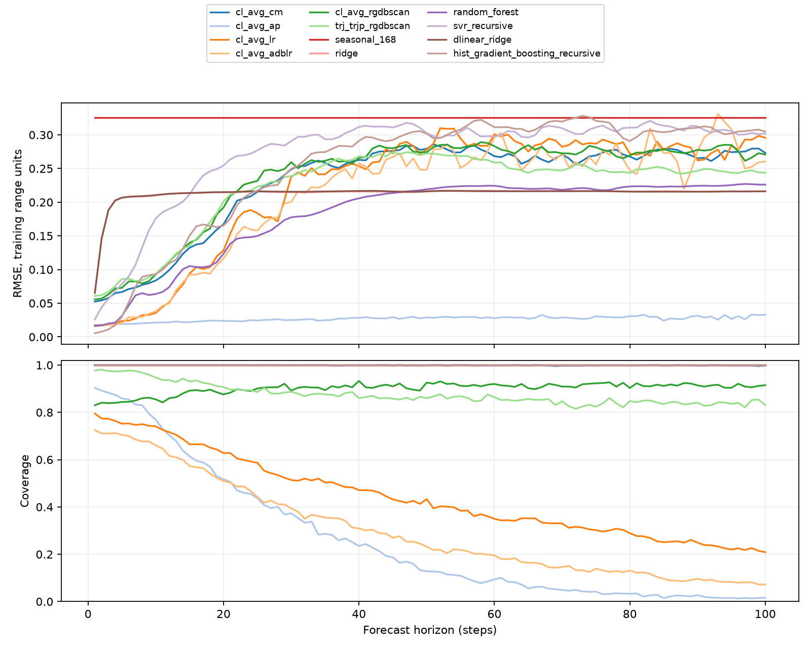
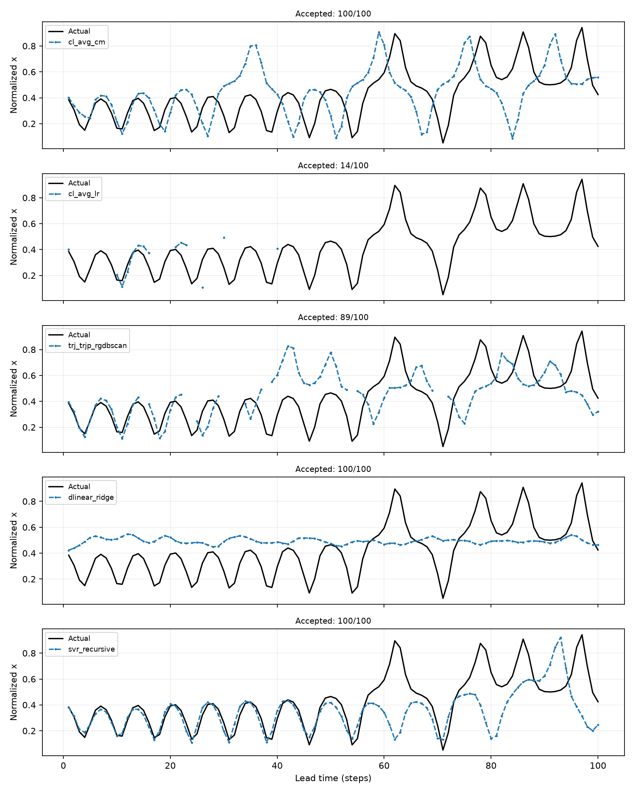
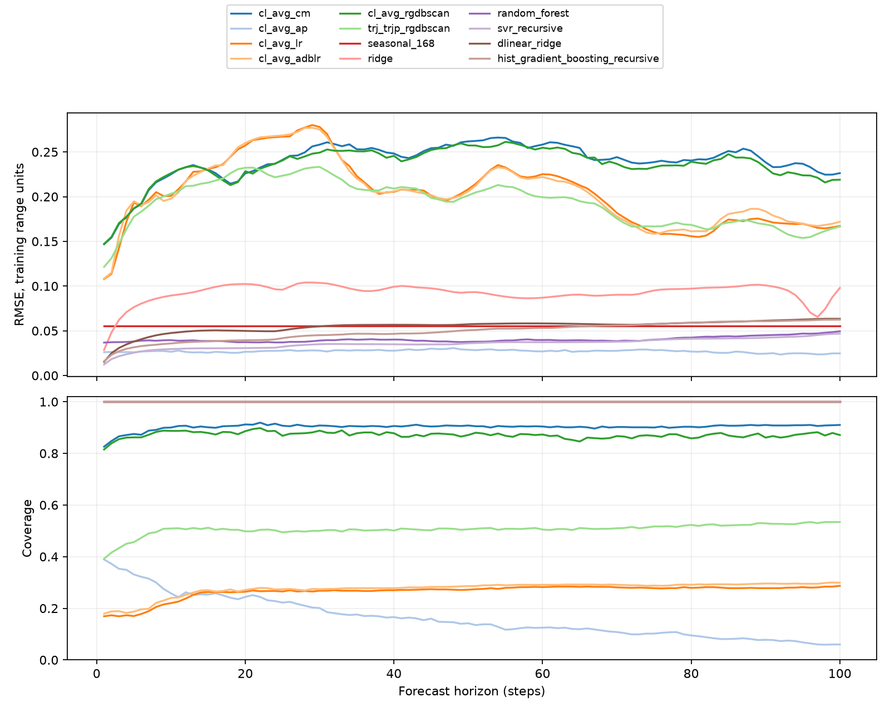
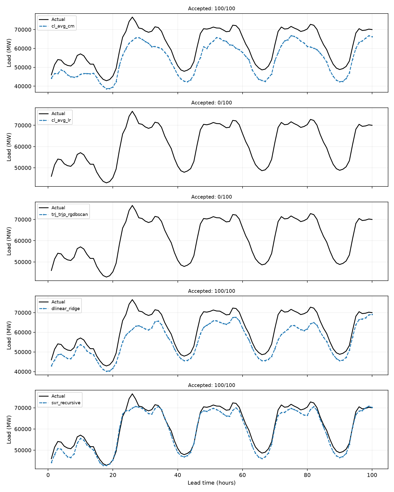

# Проверка статьи и сравнение прогнозов

Численные таблицы статьи **не воспроизведены с точностью округления**. Выполнена вычислимая реконструкция метода с явно заданными недостающими настройками. Результаты ниже получены запуском Python, все прогнозы сохранены.

## Лоренц

Train: 10000 наблюдений; validation: 1000; test: 1000. Общие 1099 origins, горизонт 100. Одна и та же пара (origin, horizon) используется каждым методом. Оценивается 100000 пар; соседние окна перекрываются и не являются независимыми наблюдениями.

По формуле (7), на каждом горизонте оценивается 1000 точек test (при test_stride=1 — весь test). Origin равен target − horizon; значения вне test исключены из метрик. Для AP доступна отдельная полная матрица истинных значений, включая промежуточные точки перед началом test.
Последние 99 значений validation исключены из обучения классификаторов и настройки всех моделей: калибровка завершается не позже самого раннего тестового origin.

RMSE в единицах нормированного ряда. Ошибка усреднена по всем горизонтам 1–100 и всем принятым прогнозам. `ap` использует будущее истинное значение и служит только оракулом.

| Метод | Покрытие | RMSE |
|---|---:|---:|
| `random_forest` | 100.0% | 0.191 |
| `decision_tree` | 100.0% | 0.201 |
| `ridge` | 100.0% | 0.213 |
| `dlinear_ridge` | 100.0% | 0.213 |
| `ridge_30` | 100.0% | 0.213 |
| `mlp` | 100.0% | 0.215 |
| `knn` | 100.0% | 0.217 |
| `hist_gradient_boosting_recursive` | 100.0% | 0.268 |
| `svr_recursive` | 100.0% | 0.282 |
| `persistence` | 100.0% | 0.297 |
| `seasonal_24` | 100.0% | 0.301 |
| `seasonal_168` | 100.0% | 0.325 |
| `cl_avg_ap` | 26.1% | 0.024 |
| `cl_avg_cm` | 99.9% | 0.241 |
| `cl_avg_lr` | 44.5% | 0.219 |
| `cl_avg_rgdbscan` | 90.1% | 0.249 |
| `trj_trjp_rgdbscan` | 87.5% | 0.229 |

Из 446 числовых ячеек статьи сравнимы 446; в пределах округления оказались 75. Совпадение отдельных ячеек не подтверждает репликацию: входы и настройки авторов не восстановлены.

Первое тестовое окно, выбранное без отбора по качеству: 

## Немецкая нагрузка

Train: 7984 наблюдений; validation: 1000; test: 1000. Общие 1099 origins, горизонт 100. Одна и та же пара (origin, horizon) используется каждым методом. Оценивается 100000 пар; соседние окна перекрываются и не являются независимыми наблюдениями.

По формуле (7), на каждом горизонте оценивается 1000 точек test (при test_stride=1 — весь test). Origin равен target − horizon; значения вне test исключены из метрик. Для AP доступна отдельная полная матрица истинных значений, включая промежуточные точки перед началом test.
Последние 99 значений validation исключены из обучения классификаторов и настройки всех моделей: калибровка завершается не позже самого раннего тестового origin.

На одной и той же маске из 50622 принятых пар SVR имеет RMSE 1403.0 МВт, а `trj_trjp_rgdbscan` — 8448.0 МВт. Это результат нашей реконструкции, а не точное воспроизведение авторского эксперимента. SVR использует историю 168 часов и календарь; метод статьи — историю 30 часов.

OPSD 2020-10-06, `DE_load_actual_entsoe_transparency`, 2015-01-01 — 2016-02-20, UTC. Начальная запись 2014-12-31T23:00Z пустая; интервал явно начинается со следующего часа. Пропуски не заполнялись. Источник исходного немецкого ряда авторы не указали.

RMSE в МВт. Ошибка усреднена по всем горизонтам 1–100 и всем принятым прогнозам. `ap` использует будущее истинное значение и служит только оракулом.

| Метод | Покрытие | RMSE |
|---|---:|---:|
| `svr_recursive` | 100.0% | 1571.955 |
| `random_forest` | 100.0% | 1749.756 |
| `knn` | 100.0% | 1873.891 |
| `decision_tree` | 100.0% | 2052.891 |
| `hist_gradient_boosting_recursive` | 100.0% | 2176.241 |
| `dlinear_ridge` | 100.0% | 2398.327 |
| `seasonal_168` | 100.0% | 2399.792 |
| `mlp` | 100.0% | 3019.456 |
| `ridge` | 100.0% | 4029.713 |
| `ridge_30` | 100.0% | 4724.691 |
| `seasonal_24` | 100.0% | 9547.950 |
| `persistence` | 100.0% | 13444.604 |
| `cl_avg_ap` | 16.2% | 1181.012 |
| `cl_avg_cm` | 90.2% | 10445.558 |
| `cl_avg_lr` | 26.5% | 9014.303 |
| `cl_avg_rgdbscan` | 87.2% | 10268.410 |
| `trj_trjp_rgdbscan` | 50.6% | 8447.976 |

Из 413 числовых ячеек статьи сравнимы 413; в пределах округления оказались 39. Совпадение отдельных ячеек не подтверждает репликацию: входы и настройки авторов не восстановлены.

Первое тестовое окно, выбранное без отбора по качеству: 

## Как читать сравнение

`metrics.csv` содержит кривые каждого метода по горизонтам, `summary.csv` — сводку. В `matched_masks.csv` каждый обычный прогнозировщик оценивается на точной маске соответствующего частичного метода; `selected_count` и `count` совпадают. Сравнения разных частичных методов на пересечениях масок исключены.

Мотивы, нормализация и регрессоры обучаются только на train. Validation используется для SMOTE/классификаторов предсказуемости, порога энтропии и выбора параметров регрессоров. Test не используется для настройки. Внутри окна используются рекурсивные или прямые прогнозы; будущие наблюдения доступны только AP. При переходе к следующему origin ранее случившиеся наблюдения доступны всем методам.

Метод статьи получает 30 прошлых значений, `ridge_30` — те же 30. Сезонные модели и остальные регрессоры используют историю до 168 часов; для Германии регрессоры также получают известный календарь. Они решают тот же тест на тех же датах с более широким контекстом; это отличие учитывается при интерпретации.

## Ограничения точной репликации

Не указаны начальная точка и координата Лоренца, конкретная нормализация, размер и положение validation, происхождение и нарезка немецкого ряда, параметры DBSCAN, число и шум траекторий, часть настроек классификаторов. Германия в статье содержит около 10 тысяч часов всего, поэтому нарезка 10 000 train + 1000 test для неё невозможна. Наши допущения перечислены в README и metadata.json.

В таблице 4 для `trj/avg/cm`, h=50, P=1 и R=0.39 дают F1≈0.561; опубликовано 0.65. Это расхождение превосходит округление. Для строк `cl` значения P/R согласуются с переставленными precision/recall предсказуемых точек. Для ряда `trj` даже эта интерпретация не согласуется с покрытием семейного оракула; использованная авторами маска неизвестна. Выгружены стандартные метрики для обеих категорий и отдельно предполагаемая конвенция статьи.

AP отбрасывает точки с |ошибка|≥ε, поэтому его RMSE обязана быть <ε. Часть опубликованных AP-RMSE превышает 0.05 и 0.01; воспроизвести их одновременно с описанным правилом при этих порогах нельзя. Статья не даёт однозначного отдельного порога AP. Полный аудит — `table_audit.json`.

Диагностические entropy/complexity и спектр Э́кмана сохранены отдельно. Параметры оценивания в статье отсутствуют; совпадение её значений не заявляется. 75.084 шага — проверенная арифметика авторской эвристики, а не доказанная граница прогнозируемости.

Оценка Э́кмана для нашего ряда Лоренца независимо совпала с upstream [`nolds.lyap_e`](https://raw.githubusercontent.com/CSchoel/nolds/master/nolds/measures.py) с максимальной разницей спектров 5.42×10⁻¹⁴. Это подтверждает соответствие реализации при выбранных настройках, а не точность восстановления истинного показателя системы. Подробности независимых сверок — `references/verification.json`.

## Источники дополнительных моделей

[Wang et al., 2025](https://www.mdpi.com/1999-4893/18/11/695) используют тот же выпуск OPSD и семейства kNN, деревьев и нейросетей. [Aksoy, 2026](https://ietresearch.onlinelibrary.wiley.com/doi/10.1049/rpg2.70378) сравнивает сезонные модели и DLinear на европейских сетях, включая немецкую. Здесь эти семейства переобучены на нашей общей нарезке; чужие опубликованные оценки не выдаются за результаты сопоставимого теста. `dlinear_ridge` сохраняет две линейные головы разложения DLinear, но обучает их совместно регуляризованным методом наименьших квадратов вместо Adam; это обозначенная модификация.

## Повторная проверка открытого кода

12 ноября 2026 года повторены веб-поиск, поиск GitHub API и проверка исходников. Публичные сторонние реализации есть: например, [MaruwanDono/PredictingChaoticTimeSeries](https://github.com/MaruwanDono/PredictingChaoticTimeSeries) и [Shuflin80/Chaotic-timeseries-prediction](https://github.com/Shuflin80/Chaotic-timeseries-prediction). Дополнительно проверены связанные ВКР Antonova и Tebiev. Подтверждённого авторского кода с исходными данными и настройками таблиц 2023 года не найдено. Перечень, версии и ограничения сохранены в `references/source_audit.json`; ссылки и краткий разбор — в README. Отсутствие других материалов этим поиском не доказано.

[Исходная статья Gromov & Baranov, 2023](https://onlinelibrary.wiley.com/doi/10.1155/2023/6689371). [Доступная копия PDF в ВШЭ](https://publications.hse.ru/pubs/share/direct/861165160.pdf).
