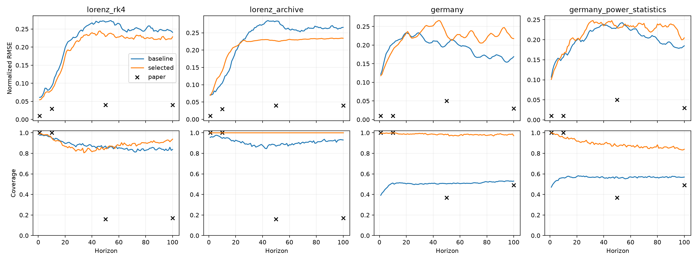
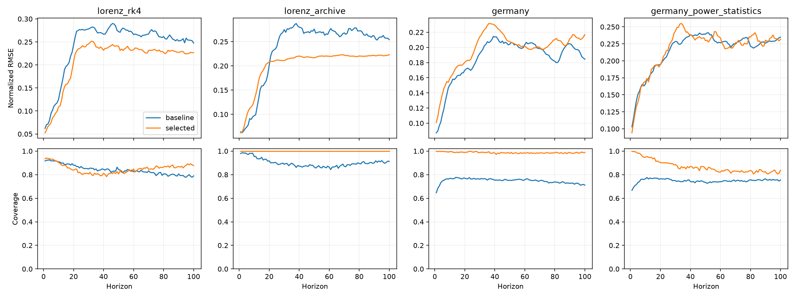

# Повторная реконструкция окружения и подбор параметров

Точное воспроизведение статьи не подтверждено. Все варианты данных опубликованы; лучший источник по test не выбирался.

Этот подбор относится к строке trj/trjp/rgdbscan и сравнению с 12 дополнительными моделями. [Предыдущая сверка формул](../fidelity/AUDIT.md) и [полный эксперимент с остальными сочетаниями](../fidelity/REPORT.md) сохранены отдельно; они не выдаются за повторный запуск всех вариантов после последнего исправления Wishart.

## Что исправлено

В Algorithm 1 слияние сохраняет кластер c1. Удалён дополнительный перенос флага completed из поглощённых кластеров через OR. Это буквальное чтение псевдокода, совпадающее с открытой реализацией Антоновой; исходный код авторов статьи не найден. Все тренировочные мотивы пересчитаны.

Для отдельного оператора spread добавлена калибровка среднего размаха конечных точек на validation по каждому горизонту, умноженного на заданный factor. Возвращается число доступных наблюдений; пустой горизонт вызывает ошибку. Интерпретация spread=ptp и исключение пустых наборов явные. Этот оператор не подменяет rgdbscan и не используется для результатов ниже.

## Данные и подбор

lorenz_rk4 — прежний генератор; lorenz_archive — закреплённый файл из связанной с авторами работы Антоновой, с удалением первых 3000 отсчётов. Нормировка архивного файла заново вычислена только по train. Тождество этого файла входу статьи не установлено.

germany — ENTSO-E Transparency из OPSD2020; germany_power_statistics — другой ряд ENTSO-E Data Portal/Power Statistics из OPSD2018. У Transparency 7984 train, у Power Statistics 8008: последний включает 24 часа 2014-12-31, соответствуя начальной дате статьи (UTC — наше допущение). Даты validation/test/fresh одинаковы: по 1000 наблюдений. Поэтому это не чистая оценка эффекта смены источника. Пропусков нет, даты не подбирались. Выпуски 2018-03-13 и 2018-06-30 Power Statistics идентичны на выбранном интервале; старые выпуски 2016/2017 не покрывают его конец.

Мотивы и нормировка фиксируются по train; наблюдаемая история обновляется до текущего origin. Частота переобучения при перемещении origin в статье не задана. Все этапы и ограничения зафиксированы в protocol.json. 32 пространственные конфигурации на профиль проверены по первому шагу, затем сохранённые кандидаты — по 100 шагам; финалисты проверены на 101 origins и двух seed. Выбор минимизирует средний RMSE по горизонтам при покрытии ≥90% на h1–10, ≥50% в целом и на каждом h50–100 ≥16% для Lorenz / ≥37% для Germany. Первые два порога — наши условия эксперимента, не параметры авторов. Если кандидатов нет, сохраняется исходная настройка.

Validation используется повторно для настройки и не служит независимым подтверждением. Старый test ранее рассматривался. Fresh не участвовал в подборе. На каждом горизонте оцениваются все 1000 целевых точек. Последние 99 наблюдений validation исключены из калибровки. Seed, масштаб и даты не подбирались по test.

## Выбранные параметры

| profile | trial | epsilon | cluster_eps | min_samples | perturbation_variance |
| --- | --- | --- | --- | --- | --- |
| lorenz_rk4 | 5 | 0.01000 | 0.03000 | 3 | 0.00010 |
| lorenz_archive | 8 | 0.05000 | 0.03000 | 10 | 0.00010 |
| germany | 5 | 0.05000 | 0.03000 | 5 | 0.00010 |
| germany_power_statistics | 5 | 0.05000 | 0.03000 | 1 | 0.00010 |

Постоянны L=4, Kmax=10, Wishart r=11/μ=.2, λ=.99, 16 траекторий; S не оптимизировалось. Финальный test/fresh оценён с seed 42 и фиксированным правилом seed для батчей. Устойчивость к числу траекторий и множество независимых запусков test не проверялись. Δ=0 допустимо в формуле статьи, но означает одинаковые детерминированные пути и нулевой ансамблевый размах; такой вариант нельзя выдавать за свидетельство эффективности стохастического ансамбля.

В rgdbscan пустой набор кластерных центров даёт неопределённый размах: сравнение не устанавливает его строгий рост и не активирует отказ. При отсутствии конечного UPV точка всё равно отвергается; один центр имеет нулевой размах. Это явное соглашение: статья не задаёт отдельного правила для пустого результата вспомогательной кластеризации. Большой min_samples относительно S может ослаблять этот критерий; причина полного покрытия архивного профиля отдельно по числу кластеров не измерялась.

## Результаты

baseline — прежние гиперпараметры после исправления Wishart; selected — настройки, выбранные только на validation. В сводке RMSE объединяет все принятые пары точка/горизонт; функция выбора усредняет отдельные RMSE по 100 горизонтам. Ошибки условны на принятых точках, поэтому покрытие приводится рядом.

Подбор улучшил средний RMSE обоих рядов Лоренца на test и fresh. Для обоих немецких источников результат отрицательный: покрытие выросло, но RMSE ухудшился на обоих периодах, в том числе на общей маске. Поэтому увеличение числа прогнозов нельзя считать улучшением точности. Эти результаты сохранены без повторной настройки по test.

| profile | partition | method | rmse | coverage |
| --- | --- | --- | --- | --- |
| lorenz_rk4 | test | baseline | 0.22930 | 0.87404 |
| lorenz_rk4 | test | selected | 0.20595 | 0.88735 |
| lorenz_rk4 | fresh | baseline | 0.24857 | 0.84077 |
| lorenz_rk4 | fresh | selected | 0.21559 | 0.84995 |
| lorenz_archive | test | baseline | 0.24007 | 0.90863 |
| lorenz_archive | test | selected | 0.21663 | 1.00000 |
| lorenz_archive | fresh | baseline | 0.24315 | 0.89901 |
| lorenz_archive | fresh | selected | 0.20648 | 1.00000 |
| germany | test | baseline | 0.19494 | 0.50674 |
| germany | test | selected | 0.22299 | 0.98480 |
| germany | fresh | baseline | 0.18759 | 0.74827 |
| germany | fresh | selected | 0.19900 | 0.98681 |
| germany_power_statistics | test | baseline | 0.20443 | 0.56427 |
| germany_power_statistics | test | selected | 0.21976 | 0.89142 |
| germany_power_statistics | fresh | baseline | 0.21761 | 0.74839 |
| germany_power_statistics | fresh | selected | 0.21852 | 0.86673 |

## На общей маске baseline и selected

| profile | partition | method | rmse | coverage |
| --- | --- | --- | --- | --- |
| lorenz_rk4 | test | baseline | 0.23259 | 0.79274 |
| lorenz_rk4 | test | selected | 0.20822 | 0.79274 |
| lorenz_rk4 | fresh | baseline | 0.25269 | 0.76164 |
| lorenz_rk4 | fresh | selected | 0.21698 | 0.76164 |
| lorenz_archive | test | baseline | 0.24007 | 0.90863 |
| lorenz_archive | test | selected | 0.21859 | 0.90863 |
| lorenz_archive | fresh | baseline | 0.24315 | 0.89901 |
| lorenz_archive | fresh | selected | 0.20961 | 0.89901 |
| germany | test | baseline | 0.19475 | 0.49860 |
| germany | test | selected | 0.21218 | 0.49860 |
| germany | fresh | baseline | 0.18754 | 0.73806 |
| germany | fresh | selected | 0.19623 | 0.73806 |
| germany_power_statistics | test | baseline | 0.20266 | 0.50940 |
| germany_power_statistics | test | selected | 0.22049 | 0.50940 |
| germany_power_statistics | fresh | baseline | 0.21597 | 0.65001 |
| germany_power_statistics | fresh | selected | 0.22080 | 0.65001 |

Снижение среднего RMSE не означает улучшения каждого показателя. Например, у lorenz_rk4 на прежнем test при h100 MAPE: 0.71809 → 0.78575. Все показатели по горизонтам доступны в [metrics.csv](metrics.csv) и [paper_comparison.csv](paper_comparison.csv).

## Сравнение с таблицами

| profile | method | horizon | rmse | mape | coverage |
| --- | --- | --- | --- | --- | --- |
| lorenz_rk4 | baseline | 1 | 0.06096 | 0.06438 | 0.97700 |
| lorenz_rk4 | baseline | 10 | 0.09217 | 0.21707 | 0.94800 |
| lorenz_rk4 | baseline | 50 | 0.26934 | 0.88614 | 0.87100 |
| lorenz_rk4 | baseline | 100 | 0.24082 | 0.71809 | 0.83800 |
| lorenz_rk4 | selected | 1 | 0.05444 | 0.05974 | 0.98900 |
| lorenz_rk4 | selected | 10 | 0.08105 | 0.18982 | 0.95100 |
| lorenz_rk4 | selected | 50 | 0.22925 | 0.79666 | 0.85200 |
| lorenz_rk4 | selected | 100 | 0.22837 | 0.78575 | 0.93800 |
| lorenz_archive | baseline | 1 | 0.07069 | 0.12086 | 0.95500 |
| lorenz_archive | baseline | 10 | 0.10466 | 0.22166 | 0.94600 |
| lorenz_archive | baseline | 50 | 0.28373 | 0.71109 | 0.87000 |
| lorenz_archive | baseline | 100 | 0.26573 | 0.63447 | 0.93000 |
| lorenz_archive | selected | 1 | 0.06911 | 0.18239 | 1.00000 |
| lorenz_archive | selected | 10 | 0.14000 | 0.37106 | 1.00000 |
| lorenz_archive | selected | 50 | 0.22660 | 0.58088 | 1.00000 |
| lorenz_archive | selected | 100 | 0.23415 | 0.57846 | 1.00000 |
| germany | baseline | 1 | 0.12150 | 0.14643 | 0.39200 |
| germany | baseline | 10 | 0.20427 | 0.22551 | 0.51100 |
| germany | baseline | 50 | 0.20226 | 0.32341 | 0.50300 |
| germany | baseline | 100 | 0.16893 | 0.23455 | 0.53000 |
| germany | selected | 1 | 0.11780 | 0.12045 | 0.99300 |
| germany | selected | 10 | 0.18668 | 0.21764 | 0.99700 |
| germany | selected | 50 | 0.22747 | 0.31430 | 0.98200 |
| germany | selected | 100 | 0.21744 | 0.30896 | 0.97200 |
| germany_power_statistics | baseline | 1 | 0.10661 | 0.10720 | 0.47100 |
| germany_power_statistics | baseline | 10 | 0.15656 | 0.17376 | 0.56300 |
| germany_power_statistics | baseline | 50 | 0.23106 | 0.33301 | 0.56900 |
| germany_power_statistics | baseline | 100 | 0.18482 | 0.25829 | 0.56900 |
| germany_power_statistics | selected | 1 | 0.10093 | 0.10231 | 0.99900 |
| germany_power_statistics | selected | 10 | 0.16319 | 0.16740 | 0.95300 |
| germany_power_statistics | selected | 50 | 0.22956 | 0.32614 | 0.86900 |
| germany_power_statistics | selected | 100 | 0.20461 | 0.29261 | 0.84000 |

В paper_comparison.csv сверены все шесть показателей строки trj/trjp/rgdbscan на h=1,10,50,100. Допуски округления: .005 для ошибок и P/R/F1, .5 процентного пункта для NP. MAPE сопоставляется как доля; конвенция единиц авторов не подтверждена. Fresh — отдельный период, его совпадение не означает воспроизведения статьи. AP — исключительно диагностический оракул с доступом к истине; в подборе и рабочих прогнозах он не участвует. Paper precision/recall используют прежнее явно отмеченное восстановление переставленных обозначений статьи; стандартные метрики сохранены рядом.

Число численных совпадений selected на test с учётом округления приведено ниже. Совпадение отдельных ячеек при неизвестных исходных данных и настройках не подтверждает воспроизведение эксперимента.

| profile | published_cells | finite_comparisons | within_rounding |
| --- | --- | --- | --- |
| lorenz_rk4 | 24 | 24 | 1 |
| lorenz_archive | 24 | 24 | 5 |
| germany | 24 | 24 | 2 |
| germany_power_statistics | 24 | 24 | 3 |

Статья сообщает для Germany RMSE .01/.01/.05/.03 при h=1/10/50/100 и покрытии 100%/100%/37%/49%; для Lorenz .01/.03/.04/.04 и 100%/100%/16%/17%. Это нормированные ошибки, не МВт.

## Диагностика рядов на train

| profile | H | C | lambda_max |
| --- | --- | --- | --- |
| lorenz_rk4 | 0.55302 | 0.38746 | 3.49267 |
| lorenz_archive | 0.55686 | 0.38828 | 3.46322 |
| germany | 0.53996 | 0.32217 | 0.08947 |
| germany_power_statistics | 0.52967 | 0.32567 | 0.09317 |

Статья: H/C/λ = .68/.45/.92 для Lorenz и .499/.372/.125 для Germany. Наши параметры оценивания указаны в diagnostics.json. Для H/C статья не задаёт даже определение меры. Здесь показана дополнительная ordinal Shannon/MPR-диагностика с D=5: её верхняя граница C около .425, поэтому опубликованное C=.45 она получить не может ни на каком ряде. Наша настройка несовместима с опубликованным числом; причина не установлена: возможны другая мера/настройки либо ошибка публикации. Это не доказывает неверность данных. [Стандартная граница MPR](https://arxiv.org/abs/2102.06786). Оцениватели не подгонялись под опубликованные числа.

## Дополнительные алгоритмы

Для каждого профиля повторены те же 12 baselines на одинаковых границах; baseline_summary.csv хранит полные ошибки, matched_masks.csv — сравнение на маске selected. Регрессоры используют до 168 прошлых значений, некоторые — календарь; метод статьи использует 30, это различие сохранено явно. Все настройки дополнительных моделей выбираются на той же validation, train не расширяется.

Ниже — описательное сравнение с лучшим результатом среди 12 baselines на данной маске. Это не новый выбор модели для эксплуатации по test: полная таблица всех методов сохранена, параметры моделей уже заморожены по validation.

| profile | partition | baseline | baseline_rmse | selected_rmse | coverage |
| --- | --- | --- | --- | --- | --- |
| lorenz_rk4 | test | random_forest | 0.19354 | 0.20595 | 0.88735 |
| lorenz_rk4 | fresh | random_forest | 0.19194 | 0.21559 | 0.84995 |
| lorenz_archive | test | random_forest | 0.18968 | 0.21663 | 1.00000 |
| lorenz_archive | fresh | random_forest | 0.19038 | 0.20648 | 1.00000 |
| germany | test | svr_recursive | 0.03621 | 0.22299 | 0.98480 |
| germany | fresh | random_forest | 0.06663 | 0.19900 | 0.98681 |
| germany_power_statistics | test | svr_recursive | 0.03717 | 0.21976 | 0.89142 |
| germany_power_statistics | fresh | knn | 0.06917 | 0.21852 | 0.86673 |

## Источники

[Статья](https://publications.hse.ru/pubs/share/direct/861165160.pdf), [архив Антоновой](https://github.com/at-antonova/time_series_prediction/tree/f78c323a461e1f990105546b24d2a548c68f0a6e), [OPSD2018](https://data.open-power-system-data.org/time_series/2018-06-30), [OPSD2020](https://data.open-power-system-data.org/time_series/2020-10-06). Повторный поиск по DOI/названию и проверка связанных репозиториев не обнаружили подтверждённую авторскую реализацию; отсутствие кода в интернете этим не доказано.

Первая попытка поиска до исправления Wishart сохранена в ../reconstruction_before_merge_fix. Она была остановлена до test и повторена после исправления с теми же правилами. GPT Astra проверял алгоритм и протокол в режиме read-only.
